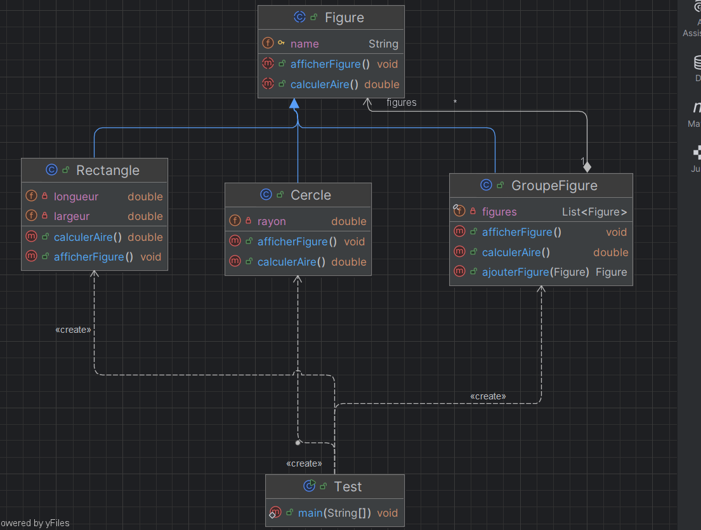
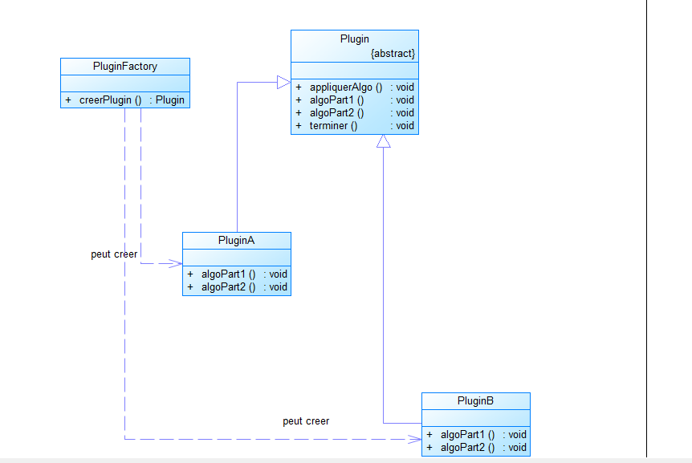
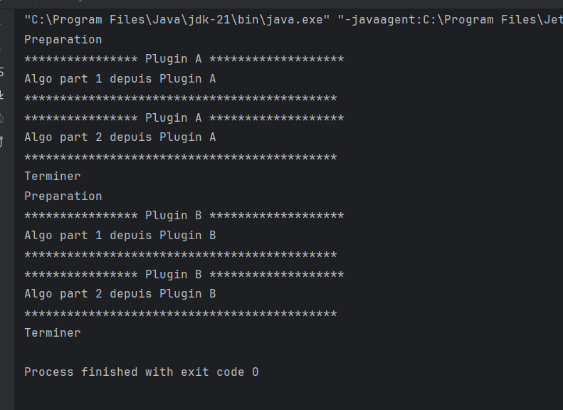

# Exercice 1 : Conception & Application des Patrons de Conception

**Module :** Conception Orientée Objet & Design Patterns  
**Enseignant :** Pr. Mohamed Youssfi  
**Étudiant :** ZOUNGRANA Charly  
**Branche Git :** `exercice-1`

---

## Sommaire de l'Exercice

L'Exercice 1 porte sur l'analyse de situations de conception récurrentes et l'identification des design patterns appropriés, accompagnés de diagrammes de classes et d'implémentations de référence :

1. [Question 1 : Modélisation de figures géométriques simples et composites](#question-1--modélisation-de-figures-géométriques-simples-et-composites) *(Traité)*
2. [Question 2 : Squelette d'algorithme et instanciation dynamique de plugins](#question-2--squelette-dalgorithme-et-instanciation-dynamique-de-plugins) *(Traité)*
3. [Question 3 : Extension dynamique de responsabilités d'un composant](#question-3--extension-dynamique-de-responsabilités-dun-composant) *(À venir)*
4. [Question 4 : Système de notification d'état à couplage faible](#question-4--système-de-notification-détat-à-couplage-faible) *(À venir)*

---

## Question 1 : Modélisation de figures géométriques simples et composites

### 1. Énoncé
> *« Une figure peut être soit un cercle, un rectangle ou un groupe de figures. »*

La problématique consiste à manipuler de façon indifférenciée des figures géométriques élémentaires (feuilles de l'arborescence) et des regroupements de figures (nœuds composites), tout en offrant les mêmes opérations (calcul de l'aire, affichage) sans coupler le code client aux types concrets.

---

### 2. Design Pattern Approprié : **Composite**

Le patron de conception structurel **Composite** répond rigoureusement à cette exigence :

- **Hiérarchie récursive (Partie / Tout) :** Il permet d'agréger des objets simples et des conteneurs d'objets au sein d'une structure arborescente unifiée.
- **Transparence opérationnelle :** Le client interagit uniquement avec l'abstraction parente (`Figure`). L'appel à `calculerAire()` ou `afficherFigure()` produit le résultat attendu, que la cible soit un élément isolé ou un ensemble composé.
- **Extensibilité (Principe Ouvert/Fermé) :** De nouvelles primitives (ex. `Triangle`, `Ellipse`) ou d'autres types de conteneurs peuvent être ajoutés sans altérer le code existant.

---

### 3. Diagramme de Classes

Le diagramme suivant présente la structure mise en œuvre pour la Question 1 :



---

### 4. Description de l'Implémentation

Le code est structuré dans le package `net.zoungrana.question1` :

#### A. Classe Abstraite `Figure` (Composant)
Point d'entrée du contrat d'abstraction :
- Définit l'attribut protégé `name`.
- Déclare les opérations communes abstraites :
  - `public abstract double calculerAire();`
  - `public abstract void afficherFigure();`

#### B. Classes Feuilles : `Cercle` et `Rectangle`
Implémentations concrètes des formes élémentaires :
- **`Cercle` :** gère l'attribut `rayon`, calcule son aire via $\pi \cdot \text{rayon}^2$ et affiche sa description spécifique.
- **`Rectangle` :** gère `largeur` et `longueur`, calcule son aire par $\text{largeur} \times \text{longueur}$ et affiche ses dimensions.

#### C. Classe Composite : `GroupeFigure`
Gestionnaire de composition :
- Encapsule une liste d'éléments `List<Figure> figures = new ArrayList<>()`.
- Fournit la méthode d'agrégation `public Figure ajouterFigure(Figure f)`.
- **Délégation récursive :**
  - `calculerAire()` : calcule la somme des aires de tous les sous-éléments via la Stream API (`figures.stream().mapToDouble(Figure::calculerAire).sum()`).
  - `afficherFigure()` : affiche le bloc d'en-tête du groupe et délègue l'affichage à chaque figure fille (`figures.forEach(Figure::afficherFigure)`).

---

### 5. Programme de Test

La classe `Test` valide la cohérence du patron :
- Instanciation d'un `Cercle` de rayon $5.0$.
- Instanciation d'un `Rectangle` de dimensions $5.0 \times 10.0$.
- Composition au sein d'une instance `GroupeFigure` (« Groupe1 »).
- Appel de `afficherFigure()` sur chaque entité et sur le groupe consolidé.

```java
package net.zoungrana.question1;

public class Test {
    public static void main(String[] args) {
        Cercle c = new Cercle("Cercle 1", 5);
        c.afficherFigure();

        Rectangle r = new Rectangle("Rectangle 1", 5, 10);
        r.afficherFigure();

        GroupeFigure g = new GroupeFigure("Groupe1");
        g.ajouterFigure(c);
        g.ajouterFigure(r);
        g.afficherFigure();
    }
}
```

---

### 6. Trace d'Exécution

#### Capture écran de la console


#### Sortie texte
```text
*************************************
Cercle 1 Rayon:5.0 Aire:78.53981633974483
*************************************
*************************************
Rectangle 1 de largeur: 5.0 et de longueur : 10.0 Aire:50.0
*************************************
-------------------- Groupe---------------------------
Aire du groupe: 128.53981633974485
*************************************
Cercle 1 Rayon:5.0 Aire:78.53981633974483
*************************************
*************************************
Rectangle 1 de largeur: 5.0 et de longueur : 10.0 Aire:50.0
*************************************
-------------------------------------------------------
```

---

## Question 2 : Squelette d'algorithme et instanciation dynamique de plugins

### 1. Énoncé
> *« Un plugin contient une opération implémentant le squelette d’un algorithme dont deux parties (partie1 et partie2) sont variables. On voudrait laisser au développeur la possibilité d’implémenter les deux parties manquantes de cet algorithme et on voudrait aussi que l’application cliente puisse instancier une implémentation concrète du plugin sans connaître sa classe d’implémentation. »*

Cette problématique introduit deux contraintes majeures de génie logiciel :
1. **Contrainte algorithmique :** Fixer la structure d'un processus global tout en externalisant certaines étapes modulables auprès de sous-classes.
2. **Contrainte d'instanciation :** Isoler le code client de toute connaissance des classes concrètes d'implémentation lors de la création d'instances.

---

### 2. Choix et Justification des Design Patterns

Pour satisfaire ces deux exigences de manière découplée, deux patrons de conception complémentaires sont combinés :

#### A. Le patron comportemental : **Template Method** (*Patron de Méthode / Méthode Modèle*)
- **Définition :** En ingénierie logicielle et selon la classification du Gang of Four (GoF), le patron **Template Method** définit le squelette invariant d'un algorithme dans une méthode de la classe mère, en déléguant la définition de certaines étapes primitives (abstraites ou configurables) aux sous-classes, sans pour autant altérer l'ordonnancement global du processus.
- **Principe d'Inversion de Contrôle (*Hollywood Principle*) :** Contrairement à un flux impératif classique, c'est la classe abstraite parente qui pilote le flux d'exécution et appelle les méthodes des sous-classes (*« Ne nous appelez pas, nous vous appellerons »*).
- **Application au cas d'étude :**
  - La classe abstraite `Plugin` déclare la méthode modèle `appliquerAlgo()`.
  - Cette méthode enchaîne rigoureusement les étapes invariantes (`preparer()` et `terminer()`) et les étapes modulables abstraites (`algoPart1()` et `algoPart2()`).
  - Les sous-classes (`PluginA`, `PluginB`) fournissent leurs implémentations spécifiques des étapes sans pouvoir modifier la séquence d'exécution globale.

#### B. Le patron créationnel : **Factory** (*Fabrique Simple / Simple Factory*)
- **Définition :** Le patron **Factory** délègue la responsabilité de l'instanciation des objets à une entité dédiée (`PluginFactory`).
- **Application au cas d'étude :**
  - La méthode statique `PluginFactory.creerPlugin(String pluginType)` instancie l'implémentation concrète demandée (`PluginA` ou `PluginB`) selon un identifiant passé en paramètre.
  - Le code client manipule exclusivement le type abstrait `Plugin`, garantissant un **couplage faible** et respectant le principe d'inversion des dépendances (DIP - *Dependency Inversion Principle*).

---

### 3. Diagramme de Classes

Le diagramme de classes illustre l'organisation entre l'abstraction, les implémentations concrètes et la fabrique :



#### Analyse des relations :
- `Plugin` est une classe abstraite déclarant la méthode modèle `appliquerAlgo()`, les méthodes invariantes (`preparer()`, `terminer()`) et les méthodes abstraites (`algoPart1()`, `algoPart2()`).
- `PluginA` et `PluginB` héritent de `Plugin` et fournissent l'implémentation concrète des deux étapes primitives.
- `PluginFactory` possède une relation de dépendance de création (`« create »` / `peut créer`) vers `PluginA` et `PluginB`. Elle retourne un objet typé par l'abstraction `Plugin`.

---

### 4. Description de l'Implémentation

Le code est structuré dans le package `net.zoungrana.question2` :

#### A. Classe Abstraite `Plugin` (Template)
Elle structure l'algorithme :
```java
package net.zoungrana.question2;

public abstract class Plugin {

    public void appliquerAlgo(){
        preparer();
        algoPart1();
        algoPart2();
        terminer();
    }

    private void preparer(){
        System.out.println("Preparation");
    }

    public abstract void algoPart1();
    public abstract void algoPart2();

    private void terminer(){
        System.out.println("Terminer");
    }
}
```
- `appliquerAlgo()` : méthode patron définissant la cinématique du traitement.
- `preparer()` et `terminer()` : étapes invariantes privées garantissant le cadre d'exécution.
- `algoPart1()` et `algoPart2()` : méthodes abstraites publiques constituant les points d'extension obligatoires.

#### B. Classes Concrètes : `PluginA` et `PluginB`
Chaque classe concrétise le comportement spécifique des deux étapes variables :
- **`PluginA` :**
  ```java
  package net.zoungrana.question2;

  public class PluginA extends Plugin {
      @Override
      public void algoPart1() {
          System.out.println("**************** Plugin A *******************");
          System.out.println("Algo part 1 depuis Plugin A");
          System.out.println("********************************************");
      }

      @Override
      public void algoPart2() {
          System.out.println("**************** Plugin A *******************");
          System.out.println("Algo part 2 depuis Plugin A");
          System.out.println("********************************************");
      }
  }
  ```
- **`PluginB` :** redéfinit également `algoPart1()` et `algoPart2()` avec un affichage adapté à `PluginB`.

#### C. Classe Créationnelle : `PluginFactory`
Elle centralise et isole la création des instances :
```java
package net.zoungrana.question2;

public class PluginFactory {
    public static Plugin creerPlugin(String pluginType){
        return switch (pluginType) {
            case "A" -> new PluginA();
            case "B" -> new PluginB();
            default -> throw new IllegalArgumentException("Le type de plugin n'existe pas");
        };
    }
}
```
Grâce à cette fabrique, le client n'a jamais besoin de faire `new PluginA()` ou `new PluginB()`. L'ajout d'une nouvelle variante de plugin se fait sans modifier le code client existant.

---

### 5. Programme de Test et Explication

La classe `Test` illustre l'utilisation transparente et découplée des composants :

```java
package net.zoungrana.question2;

public class Test {
    public static void main(String[] args) {

        Plugin pluginA = PluginFactory.creerPlugin("A");
        pluginA.appliquerAlgo();

        Plugin pluginB = PluginFactory.creerPlugin("B");
        pluginB.appliquerAlgo();

    }
}
```

#### Déroulement de l'exécution :
1. **Instanciation via la fabrique :** Le client sollicite `PluginFactory.creerPlugin("A")` puis `PluginFactory.creerPlugin("B")`. Le type de référence utilisé est exclusivement le type abstrait `Plugin`.
2. **Exécution du Template Method :** Lors de l'appel `pluginA.appliquerAlgo()`, le flux s'exécute selon l'ordonnancement fixé par la classe `Plugin` :
   - `preparer()` est exécutée (affichage `"Preparation"`).
   - `algoPart1()` spécifique à `PluginA` est exécutée.
   - `algoPart2()` spécifique à `PluginA` est exécutée.
   - `terminer()` est exécutée (affichage `"Terminer"`).
3. Le même cycle se répète de façon homogène pour `PluginB`.

---

### 6. Trace d'Exécution

#### Capture écran de la console


#### Sortie texte
```text
Preparation
**************** Plugin A *******************
Algo part 1 depuis Plugin A
********************************************
**************** Plugin A *******************
Algo part 2 depuis Plugin A
********************************************
Terminer
Preparation
**************** Plugin B *******************
Algo part 1 depuis Plugin B
********************************************
**************** Plugin B *******************
Algo part 2 depuis Plugin B
********************************************
Terminer
```

---

## Question 3 : Extension dynamique de responsabilités d'un composant

### Énoncé
> *« On dispose d’un composant implémentant une interface qui définit une opération « traitement() ». On voudrait rattacher à ce composant des responsabilités supplémentaires sans modifier son code source. C'est-à-dire envelopper l’exécution de la méthode traitement par d’autres traitements avant et après son exécution. »*

*Statut : À venir.*

---

## Question 4 : Système de notification d'état à couplage faible

### Énoncé
> *« On désire créer une classe Joueur ayant un état représenté par une variable score de type int. On voudrait que les objets de l’environnement du jeu (Couloir, Caméra et Gardien) soient informés à chaque fois que le score du joueur change tout en gardant un couplage faible entre la classe Joueur et les autres classes. »*

*Statut : À venir.*

---

## Arborescence du Projet (Branche `exercice-1`)

```text
TD-1-Design-Pattern/
├── pom.xml
├── README.md
├── diagramme-classe-exo-1-question1-real.png
├── diagramme-classe-exo-1-question-2.png
├── exo1-question-1-execution.png
├── execution-exo1-question-2.png
└── src/
    └── main/
        └── java/
            └── net/
                └── zoungrana/
                    ├── question1/
                    │   ├── Figure.java
                    │   ├── Cercle.java
                    │   ├── Rectangle.java
                    │   ├── GroupeFigure.java
                    │   └── Test.java
                    └── question2/
                        ├── Plugin.java
                        ├── PluginA.java
                        ├── PluginB.java
                        ├── PluginFactory.java
                        └── Test.java
```
