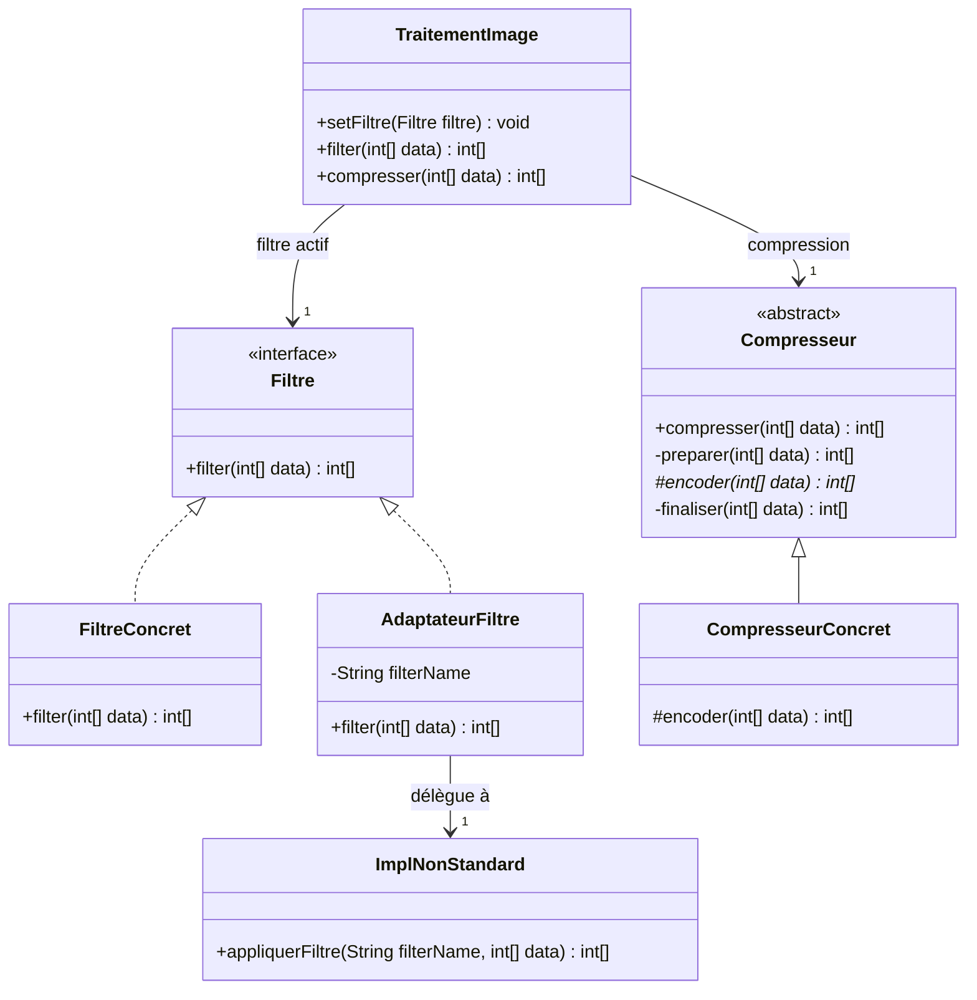

# Exercice 2 — Framework de traitement d’images

- **Module** Conception Orientée Objet & Design Patterns
- **Enseignant** Pr. Mohamed Youssfi
- **Étudiant** ZOUNGRANA Charly

[Retour au portail du TD sur `main`](https://github.com/charly-zoungrana/Activit-Pratique-N-4--TD-N-1---Design-Patterns/blob/main/README.md)

## Question 1 — Diagramme de classes

Le framework représente une image par un tableau d’entiers (`int[]`). Il expose deux opérations, `filter(int[] data)` pour le filtrage et `compresser(int[] data)` pour la compression. Il doit accepter de nouveaux algorithmes sans modification de son noyau, permettre de changer de filtre à l’exécution et intégrer la classe de filtrage existante `ImplNonStandard`.

### Diagramme UML

### Strategy — Changer le filtre à l’exécution

`TraitementImage` joue le rôle de contexte. Il conserve une référence vers un filtre actif de type `Filtre` et lui délègue l’appel à `filter(data)`. Les classes concrètes implémentent cette interface et définissent chacune leur algorithme.

Par exemple, le client peut utiliser un filtre de flou, appeler `setFiltre` avec un filtre de contraste, puis relancer `filter(data)` sur la même instance de `TraitementImage`. Le deuxième appel exécute le filtre de contraste. C’est un remplacement de stratégie. Dans l’exercice 1, question 3, **Decorator** répondait à un autre besoin en enveloppant un composant pour lui ajouter des traitements autour de son appel.

### Adapter — Intégrer le filtre existant

`ImplNonStandard` expose `appliquerFiltre(String filterName, int[] data)`. Pour l’utiliser via le contrat `Filtre`, `AdaptateurFiltre` implémente cette interface et conserve une référence à `ImplNonStandard` ainsi que le nom du filtre fourni à sa construction. Son appel `filter(data)` délègue à `appliquerFiltre(filterName, data)` et renvoie le résultat. Grâce à cette interface commune, l’adaptateur peut être sélectionné via `setFiltre` comme toute autre stratégie.

### Template Method — Fixer le déroulement de la compression

`TraitementImage.compresser(data)` délègue au `Compresseur` configuré. La classe abstraite `Compresseur` fixe l’ordre des étapes dans sa méthode publique `compresser`. Dans cette modélisation, elle prépare les données, transmet le résultat à `encoder`, puis finalise les données encodées. Chaque sous-classe implémente l’étape protégée et abstraite `encoder`. En Java, la méthode publique `compresser` sera déclarée `final` pour préserver cet ordre.

On retrouve le même principe dans l’exercice 1, question 2, où `Plugin.appliquerAlgo()` définit la séquence et délègue les étapes variables à ses sous-classes. [Voir la classe `Plugin`](https://github.com/charly-zoungrana/Activit-Pratique-N-4--TD-N-1---Design-Patterns/blob/exercice-1/src/main/java/net/zoungrana/question2/Plugin.java)

### Principe ouvert/fermé

Les deux associations de `TraitementImage` pointent vers des types d’abstraction, `Filtre` et `Compresseur`. On peut ajouter un filtre en implémentant l’interface ou un compresseur en étendant la classe abstraite. Le client fournit les instances concrètes au framework, qui conserve les mêmes appels.
