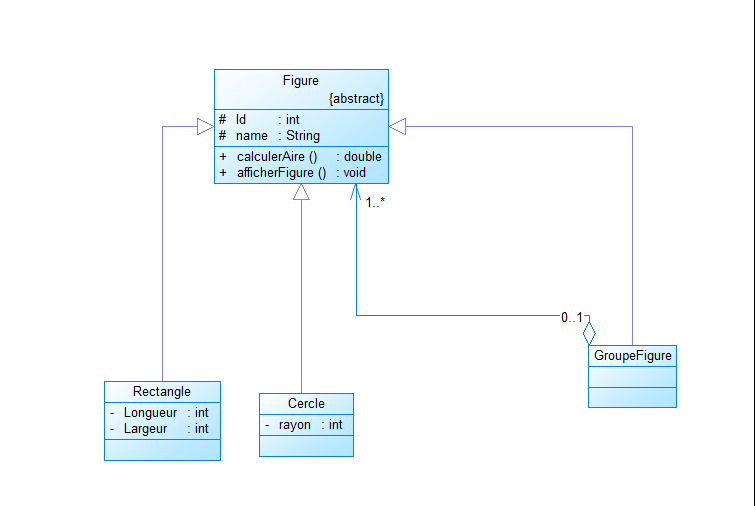
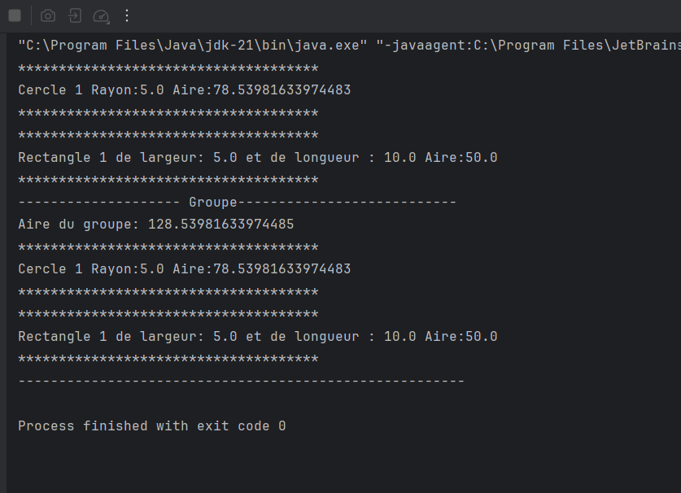

# Exercice 1 : Conception & Application des Patrons de Conception

**Module :** Conception Orientée Objet & Design Patterns  
**Enseignant :** Pr. Mohamed Youssfi  
**Branche Git :** `exercice-1`

---

## Sommaire de l'Exercice

L'Exercice 1 porte sur l'analyse de situations de conception récurrentes et l'identification des design patterns appropriés, accompagnés de diagrammes de classes et d'implémentations de référence :

1. [Question 1 : Modélisation de figures géométriques simples et composites](#question-1--modélisation-de-figures-géométriques-simples-et-composites) *(Traité)*
2. [Question 2 : Squelette d'algorithme et instanciation dynamique de plugins](#question-2--squelette-dalgorithme-et-instanciation-dynamique-de-plugins) *(À venir)*
3. [Question 3 : Extension dynamique de responsabilités d'un composant](#question-3--extension-dynamique-de-responsabilités-dun-composant) *(À venir)*
4. [Question 4 : Système de notification d'état à couplage faible](#question-4--système-de-notification-détat-à-couplage-faible) *(À venir)*

---

## Question 1 : Modélisation de figures géométriques simples et composites

### 1. Énoncé
> *« Une figure peut être soit un cercle, un rectangle ou un groupe de figures. »*

La problématique consiste à manipuler de façon indifférenciée des figures géométriques élémentaires (feuilles de l'arborescence) et des regroupements de figures (nœuds composites), tout en offrant les mêmes opérations (calcul de l'aire, affichage) sans coupler le code client aux types concrets.

---

### 2. Design Pattern Approprié : **Composite**

Le patron de conception structurel **Composite** répond rigoureusement à cette exigence :

- **Hiérarchie récursive (Partie / Tout) :** Il permet d'agréger des objets simples et des conteneurs d'objets au sein d'une structure arborescente unifiée.
- **Transparence opérationnelle :** Le client interagit uniquement avec l'abstraction parente (`Figure`). L'appel à `calculerAire()` ou `afficherFigure()` produit le résultat attendu, que la cible soit un élément isolé ou un ensemble composé.
- **Extensibilité (Principe Ouvert/Fermé) :** De nouvelles primitives (ex. `Triangle`, `Ellipse`) ou d'autres types de conteneurs peuvent être ajoutés sans altérer le code existant.

---

### 3. Diagramme de Classes

Le diagramme suivant présente la structure mise en œuvre pour la Question 1 :




---

### 4. Description de l'Implémentation

Le code est structuré dans le package `net.zoungrana.question1` :

#### A. Classe Abstraite `Figure` (Composant)
Point d'entrée du contrat d'abstraction :
- Définit l'attribut protégé `name`.
- Déclare les opérations communes abstraites :
  - `public abstract double calculerAire();`
  - `public abstract void afficherFigure();`

#### B. Classes Feuilles : `Cercle` et `Rectangle`
Implémentations concrètes des formes élémentaires :
- **`Cercle` :** gère l'attribut `rayon`, calcule son aire via $\pi \cdot \text{rayon}^2$ et affiche sa description spécifique.
- **`Rectangle` :** gère `largeur` et `longueur`, calcule son aire par $\text{largeur} \times \text{longueur}$ et affiche ses dimensions.

#### C. Classe Composite : `GroupeFigure`
Gestionnaire de composition :
- Encapsule une liste d'éléments `List<Figure> figures = new ArrayList<>()`.
- Fournit la méthode d'agrégation `public Figure ajouterFigure(Figure f)`.
- **Délégation récursive :**
  - `calculerAire()` : calcule la somme des aires de tous les sous-éléments via la Stream API (`figures.stream().mapToDouble(Figure::calculerAire).sum()`).
  - `afficherFigure()` : affiche le bloc d'en-tête du groupe et délègue l'affichage à chaque figure fille (`figures.forEach(Figure::afficherFigure)`).

---

### 5. Programme de Test

La classe `Test` valide la cohérence du patron :
- Instanciation d'un `Cercle` de rayon $5.0$.
- Instanciation d'un `Rectangle` de dimensions $5.0 \times 10.0$.
- Composition au sein d'une instance `GroupeFigure` (« Groupe1 »).
- Appel de `afficherFigure()` sur chaque entité et sur le groupe consolidé.

```java
package net.zoungrana.question1;

public class Test {
    public static void main(String[] args) {
        Cercle c = new Cercle("Cercle 1", 5);
        c.afficherFigure();

        Rectangle r = new Rectangle("Rectangle 1", 5, 10);
        r.afficherFigure();

        GroupeFigure g = new GroupeFigure("Groupe1");
        g.ajouterFigure(c);
        g.ajouterFigure(r);
        g.afficherFigure();
    }
}
```

---

### 6. Trace d'Exécution

#### Capture écran de la console


#### Sortie texte
```text
*************************************
Cercle 1 Rayon:5.0 Aire:78.53981633974483
*************************************
*************************************
Rectangle 1 de largeur: 5.0 et de longueur : 10.0 Aire:50.0
*************************************
-------------------- Groupe---------------------------
Aire du groupe: 128.53981633974485
*************************************
Cercle 1 Rayon:5.0 Aire:78.53981633974483
*************************************
*************************************
Rectangle 1 de largeur: 5.0 et de longueur : 10.0 Aire:50.0
*************************************
-------------------------------------------------------
```

---


## Arborescence du Projet (Branche `exercice-1`)

```text
TD-1-Design-Pattern/
├── pom.xml
├── README.md
├── diagramme-classe-exo-1-question-1.png
├── exo1-question-1-execution.png
└── src/
    └── main/
        └── java/
            └── net/
                └── zoungrana/
                    └── question1/
                        ├── Figure.java
                        ├── Cercle.java
                        ├── Rectangle.java
                        ├── GroupeFigure.java
                        └── Test.java
```
